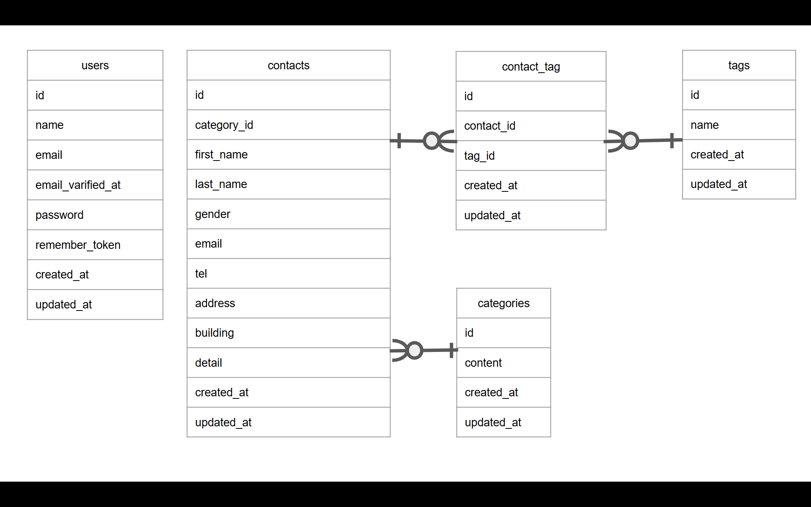

## プロジェクト名
- 「COACHTECHお問い合わせフォーム」

## 概要
- COACHTECHの確認テストで作成した成果物
- 一般ユーザーが利用する公開のお問い合わせフォーム
- 誰でもお問い合わせが送信できる
- 管理者はログイン後にお問い合わせ内容を確認・管理する

## ER図

## 環境構築手順
- このプロジェクトをローカル環境で動かすための手順

### 前提条件
- DockerおよびDocker Desktopがインストールされていること

### 手順
- Bash機能を使おうとして2時間格闘しましたができませんでした。　地の文のまま見てください。
- 1.リポジトリをクローンする
- git clone <>
- cd <>

- 2.環境変数ファイルを作成する
- cp .env.example .env

- 3.composerパッケージをインストールする
- docker run --rm \
    -u "$(id -u):$(id -g)" \
    -v "$(pwd):/var/www/html" \
    -w /var/www/html \
    laravelsail/php82-composer:latest \
    composer install

- 4.Sailを起動し、アプリケーションキーの生成とマイグレーションを行う
- ./vendor/bin/sail up -d
- ./vendor/bin/sail artisan key:generate
- ./vendor/bin/sail migrate

- 5.依存パッケージのインストールと起動
- ./vendor/bin/sail npm install
- ./vendor/bin/sail npm run dev

- 6.アプリケーションの起動
- npm run dev

- 7.動作確認
ブラウザで`http://localhost`にアクセスし、画面が表示されることを確認

## 使用技術
- Laravel 10
- MySQL 8.0
- Nginx
- Docker

## APIエンドポイント一覧
- 

## 開発環境URL
- http://localhost

## 作成者
- 渡辺瑞穂

## できなかったこと
- READMEでBASHを使うこと(2時間格闘のうえ、諦めました)
- コンタクトシーダーで、それっぽい「名前」と「名字」を作成すること(シーダーだけで3時間かかったので諦めました)
- パスワードが8文字以下の時のエラーメッセージ(自分じゃできなくてAIに聞きました)
- ログインの認証でメアドをメアド形式に指定するというバリデーション(Gemini以外から答えを得られなかったので諦めました、実装してません)
- 与えられたBladeファイルをそのまま使うこと(お問い合わせ詳細表示とお問い合わせ削除がうまく実装できず、Bladeファイルを書き換えています)
- 編集や削除などのメソッドで、->with()を使ってメッセージを表示すること　どこに表示されるのですかこれは
